# mascot 

<!-- badges: start -->
[](https://github.com/insightsurge/mascot/actions/workflows/R-CMD-check.yaml)
[](https://lifecycle.r-lib.org/articles/stages.html#experimental)
[](https://app.codecov.io/gh/insightsurge/mascot)
<!-- badges: end -->

Live, mood-driven mascots for Shiny apps and Quarto sites. A character drawn in code shows a mood and gives a short
wiggle when the mood changes, with status text beside it so the face never carries meaning alone.



Set the mood from R when a form needs attention or a task finishes. Mascots follow light and dark mode, can use your
brand colours, work offline and respect reduced-motion settings. The package is built for `GxP` work: use it alongside
your app's field errors and results.

**Status:** some features are [experimental](#development-status).

[Get started](https://insightsurge.github.io/mascot/articles/mascot.html) ·
[Meet your mascots](https://insightsurge.github.io/mascot/articles/meet-your-mascots.html) ·
[Function reference](https://insightsurge.github.io/mascot/reference/index.html)

## Installation

mascot needs R 4.1.0 or later. Install the released version from CRAN:

```r
install.packages("mascot")
```

Or install the development version from GitHub:

```r
# install.packages("pak")
pak::pak("insightsurge/mascot")
```

## Try the studio

Explore the characters and functions in a local app, change the controls and copy the R code that matches what you
see. The studio is experimental and needs the optional packages `bslib` (0.7.0 or later) and `knitr` installed.

```r
mascot::mascot_studio()
```

Run this in an interactive R session. The studio works offline and offers only the built-in characters. See
the [studio guide](https://insightsurge.github.io/mascot/articles/studio-guide.html) for each function.

## In a Shiny app

Put this in `app.R` and run it. Click **Say hello** to change Tessa's mood from idle to happy and update the status
text. Tessa gives a short wiggle as her mood changes, unless the visitor has asked for reduced motion.

```r
library(shiny)
library(mascot)

ui <- fluidPage(
  mascot(
    "helper",
    mood = "idle",
    status = "Ready to greet you",
    placement = "inline"
  ),
  actionButton("greet", "Say hello")
)

server <- function(input, output, session) {
  observeEvent(input$greet, {
    update_mascot("helper", mood = "happy", status = "Hello!")
  })
}

shinyApp(ui, server)
```

The four built-in characters are Tessa, Sela, Knurl and Neer. They share five moods: `"idle"`, `"thinking"`,
`"happy"`, `"worried"` and `"celebrating"`. Use `mascot()` in the UI and `update_mascot()` in the server to reflect
your app's state. The [Get started article](https://insightsurge.github.io/mascot/articles/mascot.html) covers forms,
long tasks, themes and more examples.

## In a Quarto page

Put this in an R chunk in a Quarto HTML page:

```r
mascot::mascot("helper", mood = "happy", status = "Rendered with Quarto", placement = "inline")
```

Here the mascot is static. Its mood and status are set when the page is rendered, and it gets no live Shiny updates. See
[Get started](https://insightsurge.github.io/mascot/articles/mascot.html) for details and caveats. A Quarto `shortcode`
is planned for 0.2.0.

## Development status

Tessa and Sela are stable. The following are experimental and may change in a later release: Knurl and Neer,
`mascot_studio()`, `mascot_preview()`, `mascot_theme(css =)`, `drag = "free"`, the mapping of `bslib::bs_theme()`
colours to character parts, and the character file format.

You can read a local JSON character file with `mascot_read_character()` or check JSON text or a parsed list with
`mascot_check_character()`. Both functions are experimental; their arguments, results and diagnostics may change
in a later release. You can preview a checked character and use it in Shiny; the studio does not take custom
characters yet. Public functions for saving and registering characters and palettes are planned for a later
release. See [Make your own character](https://insightsurge.github.io/mascot/articles/write-your-own-character.html).

The coverage badge counts the R code the tests run. The JavaScript engine that draws and animates the mascots is
tested in a browser and is not part of that figure.

The [scope and planned releases](https://github.com/insightsurge/mascot/blob/main/docs/scope.md) and
[known users](https://github.com/insightsurge/mascot/blob/main/docs/consumers.md) give the wider context.

## Getting help and contributing

Start with the [documentation](https://insightsurge.github.io/mascot/). To report a bug or suggest a feature,
[open an issue](https://github.com/insightsurge/mascot/issues) using the matching form. Include a small example
that shows the problem, built on synthetic data, and say which package version you have.

For contributions, read the [contributor guide](https://github.com/insightsurge/mascot/blob/main/.github/CONTRIBUTING.md),
including its [conduct and data guidance](https://github.com/insightsurge/mascot/blob/main/.github/CONTRIBUTING.md#conduct-and-data).
Everyone taking part is asked to follow the [code of conduct](https://github.com/insightsurge/mascot/blob/main/.github/CODE_OF_CONDUCT.md).
To report a security problem privately, see the [security policy](https://github.com/insightsurge/mascot/blob/main/.github/SECURITY.md).
The [engineering standards](https://github.com/insightsurge/mascot/blob/main/docs/standards.md) explain the package's
checks and conventions.

## Licence

MIT. See the [licence](https://github.com/insightsurge/mascot/blob/main/LICENSE.md).
