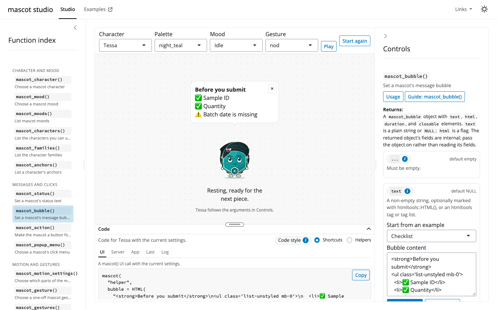
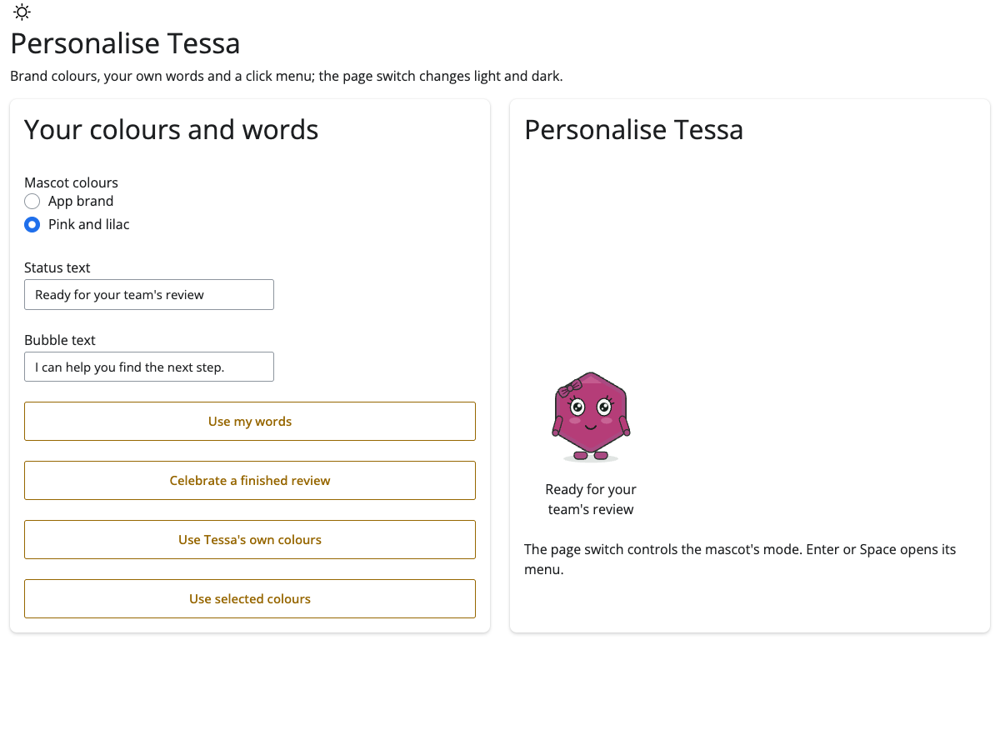
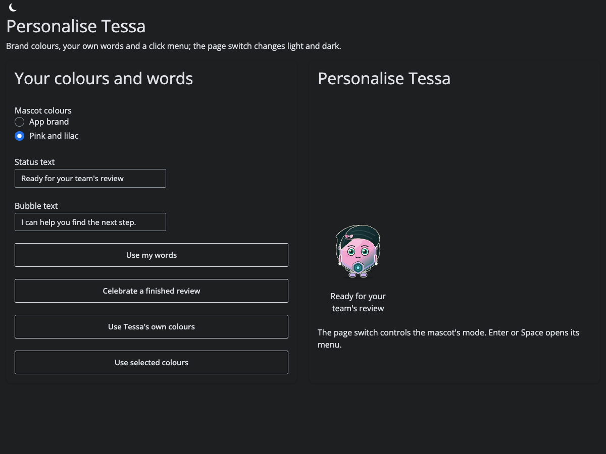
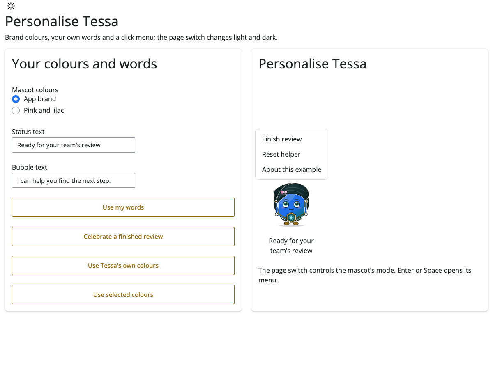
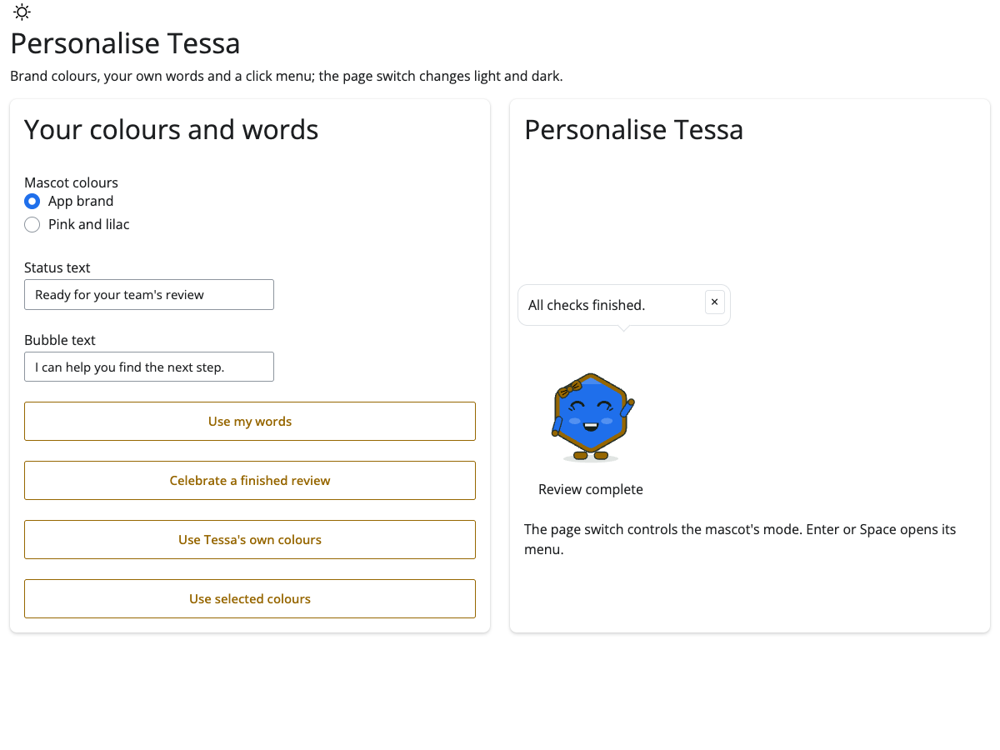

```{r setup, include=FALSE}
knitr::opts_chunk$set(collapse = TRUE, comment = "#>")
library(mascot) # nolint: undesirable_function_linter.
```

A mascot is a character drawn in code beside your app's ordinary feedback.
Tessa can look worried while a form needs attention, think while work runs,
and celebrate when it finishes. Status text carries the meaning even when
someone cannot see the drawing or prefers less movement.

The package works offline. It is built for good practice (`GxP`) work: the app
supplies the state and the words, and no AI service is involved. A mascot
complements field errors and results; it does not replace them.

If the Shiny connection drops, the mascot shows its worried face and a
connection message until the app reconnects.

## Your first app

Put this code in an `app.R` file and run it from an interactive R session.
Click **Finish review** to change Tessa's mood and message together.

```{r first-app, eval=FALSE}
library(shiny)
library(mascot)

ui <- fluidPage(
  h1("Sample review"),
  actionButton("finish", "Finish review"),
  mascot("helper", status = "Ready to review")
)

server <- function(input, output, session) {
  observeEvent(input$finish, {
    update_mascot("helper", mood = "happy", status = "Review complete",
      bubble = mascot_bubble("All rows checked.", duration = 5))
  })
}

shinyApp(ui, server)
```

`mascot("helper", ...)` belongs in the UI; `update_mascot("helper", ...)`
belongs in the server. Arguments after the id must be named.

Give each mascot its own id.

### Show the mascot later

To add the mascot only when it is needed, build it in the server with
`renderUI()` and place `uiOutput()` in the UI. Updates sent before it appears
are kept until it does, so the first `update_mascot()` can run in the same
observer.

```{r show-later, eval=FALSE}
library(shiny)
library(mascot)

ui <- fluidPage(
  actionButton("start", "Start the review"),
  actionButton("finish", "Finish"),
  uiOutput("helper_ui")
)

server <- function(input, output, session) {
  shown <- reactiveVal(FALSE)
  output$helper_ui <- renderUI({
    req(shown())
    mascot("helper", status = "Reviewing")
  })
  observeEvent(input$start, {
    shown(TRUE)
    # Sent before the mascot exists: kept until it appears.
    update_mascot("helper", mood = "thinking")
  })
  observeEvent(input$finish, {
    update_mascot("helper", mood = "happy", status = "Review complete")
  })
}

shinyApp(ui, server)
```

The `reactiveVal()` makes the mascot appear once: clicking **Start the review**
again does not rebuild it, so it keeps its mood and position.

## Open an example

Start with mascot studio, `mascot_studio()`. Select a function in the index on
the left; its arguments appear in the controls on the right, and one live Tessa
follows your changes. Each argument's information button shows its help text,
and the Guide button opens the function's help with pictures and common
mistakes. Selecting `mascot_preview()` shows its static page in place of the
live mascot. The Code tray under the canvas holds UI, server and whole-app code
to copy, plus the last call and an event log; collapse it from its header, drag
its top edge to resize it, or open it full screen. Both side panels collapse.
The four other apps each show one scenario.



```{r catalogue}
mascot_examples()
```

```{r run-example, eval=FALSE}
mascot_example("studio")
```

To read a scenario without running it:

```{r locate-example}
app_file <- mascot_example("form-check", run = FALSE)
basename(app_file)
```

Each scenario's `app.R` contains its UI and server and runs alone when copied
into a project with shiny, `bslib` and mascot installed. Layout uses ordinary
`bslib` cards. The studio is a folder: `app.R`, with its helpers in `R/`
and its styles in `www/`. `mascot_example()` does not copy or write files.

## Moods and status

```{r moods}
mascot_moods()
```

```{r mood-helpers, results="hide"}
mascot_mood("worried")
mascot_status("2 fields need attention")
mascot_character("tessa")
```

Tessa and Sela are stable built-in characters: their ids, names, five shared
moods, gesture names, colour-role names and palette names stay the same in
every release, while their drawings, motion and exact palette colours may be
polished. Knurl and Neer are experimental: any part may change, and neither will
be removed without a warning in the release before its removal. The character file
format and authoring functions are experimental too. `mascot_character()`
selects a character; it does not create a new one. The plain names
`character = "tessa"` and `mood = "worried"` are shortcuts for their helpers.

`mascot_characters()` lists the characters this R session knows, and
`mascot_families()` their families. Give a character to a listing to see what
it declares: `mascot_moods("tessa")` adds the status text of each mood, and
`mascot_gestures("tessa")` the length of each movement. `mascot_anchors()` and
`mascot_palettes()` list a character's attachment points and colour palettes.

```{r character-listings}
mascot_characters()
mascot_gestures("tessa")
```

Without custom status, Tessa's line follows the mood: **Working out how the
parts fit.**, **That came together nicely.**, and so on. Custom status stays
until replaced or reset.

```{r status-update, eval=FALSE}
update_mascot("helper", mood = mascot_mood("worried"),
  status = mascot_status("2 fields need attention"))
update_mascot("helper", status = mascot_status()) # Follow the mood again.
```

Try `mascot_example("form-check")` for a plain `observe()` that checks two
fields. It uses no extra validation package. Try `mascot_example("long-task")`
for a slow step run with `shiny::ExtendedTask`: Tessa thinks while it runs and
turns happy or worried when it finishes, and the app stays responsive. The
example's task is a two-second promise; for real work, return
`mirai::mirai(...)` from the task function. Automatic busy and validator
watchers are not available yet; these apps send explicit updates.

## Message bubbles

Bubbles are separate from status. Plain text is escaped; deliberate HTML or
self-contained `htmltools` tags can be supplied when your app needs them.

```{r bubbles, results="hide"}
mascot_bubble("Three rows skipped.") # Five seconds by default.
mascot_bubble("Check the source data.", duration = Inf)
mascot_bubble() # Clear an existing bubble when sent in an update.
```

A bubble stays until closed when `duration = Inf`. Timed bubbles
pause on hover or keyboard focus, and while the mascot is minimised. The
close button is present by default. A bubble survives a mood change unless
you replace or clear it. Pausing while a tab is hidden is still pending.

Try the bubble examples, including your own HTML, in
`mascot_example("studio")`, or the lasting error
message in `mascot_example("long-task")`.

## One-off gestures

```{r gestures}
mascot_gestures()
```

```{r gesture-helper, results="hide"}
mascot_gesture("wave")
```

```{r gesture-update, eval=FALSE}
update_mascot("helper", gesture = mascot_gesture("nod"))
```

Gestures are named-only in `update_mascot()`; they are not a persistent mood.
The visitor's reduced-motion preference can suppress them. A gesture sent
before the mascot appears plays once when it does. A character
swap has its own wave and takes precedence over a gesture in the same update.
Try both gestures in `mascot_example("studio")`.

## Size and placement

The default is 160 pixels, floating in the bottom-right corner as an assistant,
with a minimise control. Use `minimise = FALSE` to hide that control.
Use `placement = "inline"` to place a mascot in the page flow.

```{r layout, results="hide"}
mascot_size(180, small_screen = 72)
mascot_size("20%")
mascot_placement("bottom-right", minimise = TRUE)
```

Percentages use the container width inline and the window width when floating.
Every size draws the full character. Inline mascots reserve space above the
drawing for a bubble, even before one appears, to avoid moving the page.
A floating mascot can sit in any corner;
its minimise control appears on hover or keyboard focus, and stays available
on touch. The restore button stays reachable while minimised. Opening a mascot
menu hides the action controls until the menu closes.

Inline mascots ignore `minimise` and `drag`. Explicitly setting either in
`mascot_placement()` or a placement list gives an informational message,
including in `update_mascot()`; defaults such as `mascot_placement("inline")`
stay silent. The browser receives both controls as `FALSE` inline.

```{r layout-update, eval=FALSE}
update_mascot("helper", size = mascot_size(180, small_screen = 72),
  placement = mascot_placement("top-left", minimise = TRUE))
update_mascot("helper", placement = mascot_placement("inline")) # Return inline.
```

Try the size and placement controls in `mascot_example("studio")`, and the
parent-owned corner helper in `mascot_example("modules")`.

### Let visitors move it

`drag = "none"` (the default) disables dragging. A floating mascot can be dragged by its drawing, with a mouse or a finger.
Dragging is off by default. With `drag = "snap"` the mascot moves to the
nearest corner when it is dropped; with `drag = "free"` it stays where it is
dropped, kept inside the window. A click without movement still opens its menu.
While minimised, drag the round restore button with the same rules. A click
without movement restores the mascot; a drag leaves it minimised. After a
snap, restoring shows the mascot in its new corner.

```{r drag, eval=FALSE}
mascot("helper",
  placement = mascot_placement("bottom-right", drag = "snap"))
```

Each drop sets `input$helper_position`: the corner, such as `"top-left"`,
after a snap, or a list with `x` and `y` in pixels after a free drop. A later
`update_mascot(placement = ...)` replaces where the visitor put it. To remember
the corner between visits, save it in your app and pass it back as `position`.

## Theme and light/dark mode

No theme means Tessa's own colours. Brand colours are used only when you ask.

A palette is a named theme for one character: use `mascot_palettes("knurl")` to
list choices, then `mascot("helper", character = "knurl", theme = "orbit")`.
Use `mascot_theme(palette = "orbit", light = list(body = "#d0d8e0"))` to put your
role colours on top; CSS variables win last. `theme = "original"` restores the
character's own colours in an update, while `NULL` leaves them unchanged. A
character may also name its own colours: Tessa's are `night_teal`, listed first
by `mascot_palettes("tessa")`, and `"original"` selects the same colours. A
character swap keeps a palette with the same id when available; otherwise R
warns, restores the incoming character's colours and keeps your explicit colours
for shared roles. Built-in palettes do not give contrast warnings; your added
colours are checked as usual. `mascot_colour_roles("knurl", palette = "orbit")`
shows the palette's colours, including derived followers.
A named list supplies selected roles in every mode. Unset roles follow the
character's declared leaders: `list(body = "#c2185b")` gives pink sleeves,
eyelids and feet, plus lighter pink highlights. Feet follow a supplied rim
before the body, and sleeves follow a supplied body shade before the body. The
bow, the hair, the badge and the iris have their own colours (`accessory`,
`hair`, `badge`, `iris`), and the detail of the bow becomes a darker shade. A
supplied sleeve or other role always wins. With no supplied or filled leader,
the original colour stays. Outline, face lines, eye whites, shine, teeth,
hands, sweat and shadow keep their colours.

`mascot_colour_roles()` lists `follows` (leaders in priority order) and `shade`
(`same`, `lighter` or `darker`); `NA` means there is no follow rule. Its
`description` column says what each role colours, and `brand` marks the roles
that take a `bslib` primary or secondary colour. Derived
shades preserve hue using calibrated lightness and saturation shifts.
Feeding Tessa's own body, body shade, rim and bow colours back reproduces her derived
colours within 3 units per RGB channel (0--255). Supplied colours stay exact.

```{r roles}
mascot_colour_roles("tessa")
```

```{r two-palettes, results="hide"}
mascot_theme(
  light = list(body = "#1f6feb"),
  dark = list(body = "#9ec5fe"),
  mode = "auto"
)
```

```{r theme-update, eval=FALSE}
mascot("helper", theme = list(body = "#1f6feb", rim = "#966600"))
update_mascot("helper", theme = mascot_theme()) # Restore original colours.
```

With `bslib` installed, primary supplies Tessa's body and secondary supplies
her rim. Her follow rules also colour sleeves, eyelids and feet.

```{r bslib-theme, eval=FALSE}
if (requireNamespace("bslib", quietly = TRUE)) {
  mascot("helper", theme = bslib::bs_theme(
    primary = "#1f6feb", secondary = "#966600"
  ))
}
```

A `bs_theme()` supplies the same brand colours in both modes. For different
colours per mode, use `mascot_theme(light = ..., dark = ...)`.
`_brand.yml` enters through `bslib::bs_theme(brand = ...)`.

The default `mode = "auto"` follows the nearest valid `data-bs-theme` from the
mascot's original place in the page, then Quarto's body classes. Without a
page signal it stays light, even if the system prefers dark; the speech bubble follows the same signal. Explicit
`"light"` or `"dark"` wins. Plain lists and `bs_theme()` follow the page too.
A character swap resolves the incoming character's follow rules again.

Try `mascot_example("branding")`: `bslib::input_dark_mode()` switches the
page and the mascot together, with no server theme update. The original-colours
button resets Tessa without changing the page theme.

### Pink and lilac

Choose **Pink and lilac** for explicit light and dark palettes. You only need
to supply leaders; individual roles can override their followers for full control.

```{r pink-theme, results="hide"}
pink_theme <- mascot_theme(
  light = list(body = "#B53D78", rim = "#A94A82"),
  dark = list(body = "#F2A6CF", rim = "#C5B0EB")
)
```

```{r pink-theme-use, eval=FALSE}
mascot("helper", theme = pink_theme)
# Or change an existing mascot from the server:
update_mascot("helper", theme = pink_theme)
```





CSS variables are an **experimental** source:

```{r css-theme, eval=FALSE}
mascot("helper", theme = mascot_theme(
  css = list(body = "--bs-primary"), mode = "auto"
))
```

A missing or invalid CSS variable uses the character's original role colour
and warns in the browser console. R warns when a supplied colour has less
than 3:1 contrast against the checked background in Shiny development mode,
but retains your choice. Previews and the studio always warn by default.
`options(mascot.contrast_warnings = TRUE)` or `FALSE` forces R warnings on
or off everywhere.
CSS contrast warnings appear in the browser console. Review your actual app
background as well; a warning does not adjust a colour for you.

## Motion

```{r motion, results="hide"}
mascot_motion_settings(idle = FALSE)
mascot_motion_settings(messages = "menu", others = FALSE)
mascot("still", motion = FALSE)
```

Each part moves independently: `idle` controls breathing and blinking,
`mood_change` the wiggle or hop, `gestures` nods and waves, `swap` the
character transition, and `minimising` and `restoring` the short movement
to the round restore button and back. `messages` takes `TRUE`, `FALSE`,
or panel names from `c("bubble", "tooltip", "menu")`; still panels keep working.
Unnamed switches, including future switches, follow `others`; named switches
always win. `NULL` follows `others`.

`motion = FALSE` stops all movement, including panel appearance, the drag snap,
minimising and restoring. The visitor's
[reduced-motion setting](https://developer.mozilla.org/en-US/docs/Web/CSS/@media/prefers-reduced-motion)
always wins over any `TRUE`. Idle movement settles within five seconds.
Settings play nothing; use `mascot_gesture()` to play a movement. A gesture
sent with `gestures = FALSE` is skipped, while the mood, bubble and status in
the same update still apply. Shiny development mode reports the skipped gesture.

```{r motion-update, eval=FALSE}
update_mascot("helper", motion = mascot_motion_settings(gestures = FALSE))
```

Try each switch and the panel multi-select in `mascot_studio(fn = "mascot_motion_settings")`.

## Clicks and menus

By default a mascot is a picture: clicking it does nothing, and the keyboard
skips it. `click` makes it a button, for one action of your app or for a menu.
Every action activation (a click or tap, Enter or Space) sets `input$helper_click`, a
count, so your server can answer it:

```{r action, eval=FALSE}
# In the UI: a label says what a click does, for screen readers and in a tooltip.
mascot("helper", click = "Open help")

# In the server:
shiny::observeEvent(input$helper_click, {
  shiny::showModal(shiny::modalDialog("Help for this app", easyClose = TRUE))
})
```

`mascot_action("Open help", tooltip = FALSE)` hides the tooltip, and
`disabled = TRUE` keeps the button but sends nothing, for example during a long
task; `mascot_popup_menu(..., disabled = TRUE)` likewise opens nothing. For several actions, the app supplies menu labels and handles the choice;
the mascot opens the menu. Enter and Space open or close the focused toggle.
Arrow keys, Home, End and Escape navigate the open menu.

```{r menu, eval=FALSE}
# In the UI:
mascot("helper", click = mascot_popup_menu(
  c(finish = "Finish review", reset = "Reset helper", about = "About this app")
))

# In the server:
shiny::observeEvent(input$helper_menu, {
  if (identical(input$helper_menu, "finish")) {
    update_mascot("helper", mood = "happy", status = "Review complete",
      bubble = mascot_bubble("All checks finished.", duration = Inf),
      gesture = mascot_gesture("nod"))
  }
  if (identical(input$helper_menu, "reset")) {
    update_mascot("helper", mood = "idle", status = "Ready to review",
      bubble = mascot_bubble())
  }
  if (identical(input$helper_menu, "about")) {
    shiny::showModal(shiny::modalDialog("About this app", easyClose = TRUE))
  }
})
```

Menu labels are clickable text items. Their names (`finish`, `reset`,
`about`) arrive in `input$helper_menu`; they are not Shiny action-button
counts. The menu does not accept arbitrary widgets such as sliders.
Reset above clears the feedback and keeps the selected colours.





Click or touch the drawing, or focus it and press Enter/Space with keyboard
opening enabled. Escape closes the menu. Repeated choices trigger repeated
events. Opening and closing the menu never set `input$helper_click`. An
empty helper, `mascot_action()` or `mascot_popup_menu()`, removes the click when
sent in an update. On static pages the mascot remains an image; clicks need
Shiny.
Try all three actions in `mascot_example("branding")`.

## Modules

Create a module mascot with `ns("helper")` in its UI. Update it with the local
id `"helper"` inside the same module's server. Shiny applies the prefix once.
A menu choice arrives as `input$helper_menu` in that module.

```{r module, eval=FALSE}
helper_ui <- function(id) {
  ns <- shiny::NS(id)
  shiny::tagList(
    shiny::actionButton(ns("finish"), "Finish review"),
    mascot(ns("helper"))
  )
}
helper_server <- function(id) {
  shiny::moduleServer(id, function(input, output, session) {
    ready <- shiny::reactiveVal(FALSE)
    shiny::observeEvent(input$finish, {
      ready(TRUE)
      update_mascot("helper", mood = "happy")
    })
    ready
  })
}
```

For an app-wide mascot, create it once in the parent's UI. Let a child return
a reactive value, then have the parent observe that value and update its own
mascot. `mascot_example("modules")` shows two children with separate helpers
and one shared parent helper. It includes working inputs and the complete app.

## Personalise Tessa

Start with the branding example. Choose your team's colours, status and bubble
text; keep ordinary error messages beside the fields they describe. Inspect
`mascot_colour_roles()` before choosing roles, and review contrast in both
modes. Personalising these settings keeps Tessa's existing shape and identity.

A new named character comes later with `mascot_remix()`.
The Quarto `shortcode` and fuller static-site guidance are separate upcoming work.

## Check a look before using it

`mascot_preview()` makes one offline page with every mood in light and dark,
then compares your requested size with 160, 96 and 24 pixels. Motion is off by
default so you can inspect the faces. Assign the result to build it without
opening a Viewer; print it when you want to look:

```{r preview, eval=FALSE}
page <- mascot_preview(theme = mascot_theme(
  light = list(body = "#B53D78", rim = "#A94A82"),
  dark = list(body = "#F2A6CF", rim = "#C5B0EB")
))
page
attr(page, "contrast")
mascot_preview(mood = "happy", size = 96)
```

Follow rules coordinate the coloured parts. A `bs_theme()` uses `bg`/`fg` for
the light panel and `body-bg-dark`/`body-color-dark` for the dark panel.
Supplied colours below 3:1 against the panel background
are kept and listed above the grids, with one combined warning in R of class `mascot_contrast`.
`attr(page, "contrast")` returns their role, colour, background, ratio and mode.
Experimental CSS values are only known in the browser; look in its console for
those warnings. Previews show mascots inline for comparison. Status text
remains beside each mascot; fine face details are harder to read at 24 pixels.

## Leave unchanged or reset

In `update_mascot()`, `NULL` leaves a setting unchanged. Use an empty helper
when the setting has a clear/reset action:

| Setting | Reset sent to `update_mascot()` |
|---|---|
| Character | `character = mascot_character()` (back to `"tessa"`) |
| Mood | `mood = mascot_mood()` (back to `"idle"`) |
| Size | `size = mascot_size()` (160, `small_screen = "auto"`) |
| Custom status | `status = mascot_status()` follows the mood |
| Bubble | `bubble = mascot_bubble()` removes it |
| Theme | `theme = mascot_theme()` restores character colours |
| Click | `click = mascot_action()` (or `mascot_popup_menu()`) removes it |
| Placement | `placement = mascot_placement()` resets to default bottom-right; `mascot_placement("inline")` returns inline |
| Motion | `motion = mascot_motion_settings()` allows movement subject to visitor preference |

Each non-`NULL` argument replaces that whole setting, not part of it (example: `update_mascot("h", size = 200)` also resets a custom `small_screen` to `"auto"`).

An invalid update warns and leaves the complete update unchanged. During app
construction, invalid arguments stop with an error. This helps catch a typo
without applying half of a change.
