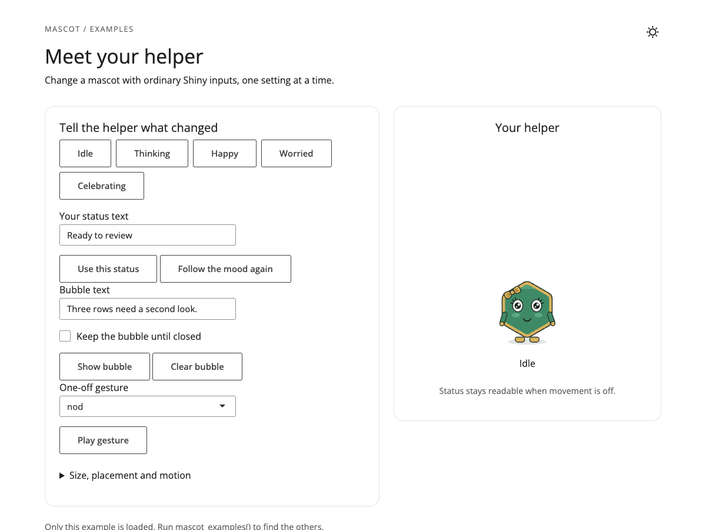

```{r setup, include=FALSE}
knitr::opts_chunk$set(collapse = TRUE, comment = "#>")
library(mascot) # nolint: undesirable_function_linter.
```

A mascot is a character drawn in code beside your app's ordinary feedback.
Tessa can look worried while a form needs attention, think while work runs,
and celebrate when it finishes. Status text carries the meaning even when
someone cannot see the drawing or prefers less movement.

The package works offline. It is built for `GxP` work: the app supplies the
state and the words, and no AI service is involved. A mascot complements
field errors and results; it does not replace them.

## Your first app

Put this code in an `app.R` file and run it from an interactive R session.
Click **Finish review** to change Tessa's mood and message together.

```{r first-app, eval=FALSE}
library(shiny)
library(mascot)

ui <- fluidPage(
  h1("Sample review"),
  actionButton("finish", "Finish review"),
  mascot(id = "helper", status = "Ready to review")
)

server <- function(input, output, session) {
  observeEvent(input$finish, {
    updateMascot("helper", mood = "happy", status = "Review complete",
      bubble = mascot_bubble("All rows checked.", duration = 5))
  })
}

shinyApp(ui, server)
```

`mascot()` belongs in the UI; `updateMascot()` belongs in the server.
There is no `mascotOutput()` or `renderMascot()`. Give each mascot its own id.



## Open an example

The package includes five small apps. Each opens only the requested scenario,
using the same layout; there is no example chooser to navigate first.

```{r catalogue}
mascot_examples()
```

```{r run-example, eval=FALSE}
mascot_example("basic")
```

To read a scenario without running it:

```{r locate-example}
app_file <- mascot_example("basic", run = FALSE)
basename(app_file)
```

Each `app.R` contains its scenario's UI and server. It loads a shared layout
from `examples/shared/shell.R` in the installed package. Keep that layout
available if adapting the complete app, or copy just the mascot calls into
your existing UI and server. `mascot_example()` does not copy or write files.

## Moods and status

```{r moods}
mascot_moods()
```

```{r mood-helpers, results="hide"}
mascot_mood("worried")
mascot_status("2 fields need attention")
mascot_character("tessa")
```

Only Tessa is built in at present. `mascot_character()` selects a character;
it does not create a new one. The plain names `character = "tessa"` and
`mood = "worried"` are shortcuts for their helpers.

Without custom status, the line follows the mood: **Thinking**, **Happy**,
and so on. Custom status stays until replaced or reset.

```{r status-update, eval=FALSE}
updateMascot("helper", mood = mascot_mood("worried"),
  status = mascot_status("2 fields need attention"))
updateMascot("helper", status = mascot_status()) # Follow the mood again.
```

Try `mascot_example("form-check")` for a plain `observe()` that checks two
fields. It uses no extra validation package. Try `mascot_example("long-task")`
for thinking, success and failure states. Its short delay uses `ExtendedTask`
when available and a plain callback otherwise. The delay still blocks R;
real background work needs an asynchronous task function. Automatic busy and
validator watchers are not available yet; these apps send explicit updates.

## Message bubbles

Bubbles are separate from status. Plain text is escaped; deliberate HTML or
self-contained `htmltools` tags can be supplied when your app needs them.

```{r bubbles, results="hide"}
mascot_bubble("Three rows skipped.") # Five seconds by default.
mascot_bubble("Check the source data.", duration = Inf)
mascot_bubble() # Clear an existing bubble when sent in an update.
```

A bubble stays until closed when `duration = Inf` or `NULL`. Timed bubbles
pause on hover or keyboard focus, and while the mascot is minimised. The
close button is present by default. A bubble survives a mood change unless
you replace or clear it. Pausing while a tab is hidden is still pending.

Try the bubble controls in `mascot_example("basic")`, or the lasting error
message in `mascot_example("long-task")`.

## One-off gestures

```{r gestures}
mascot_gestures()
```

```{r gesture-helper, results="hide"}
mascot_gesture("wave")
```

```{r gesture-update, eval=FALSE}
updateMascot("helper", gesture = mascot_gesture("nod"))
```

Gestures are named-only in `updateMascot()`; they are not a persistent mood.
The visitor's reduced-motion preference can suppress them. Send them after
the mascot is mounted: early gestures are currently dropped. A character
swap has its own wave and takes precedence over a gesture in the same update.
Try both gestures in `mascot_example("basic")`.

## Size and placement

The default is 160 pixels, inline where you put it in the UI.

```{r layout, results="hide"}
mascot_size(180, small_screen = 72)
mascot_size("20%")
mascot_placement(floating = TRUE, position = "bottom-right", minimise = TRUE)
```

Percentages use the container width inline and the window width when floating.
Small drawings simplify by default. Inline mascots reserve space above the
drawing for a bubble, even before one appears, to avoid moving the page.
A floating mascot can sit in any corner;
its minimise control appears on hover or keyboard focus, and stays available
on touch. The restore button stays reachable while minimised. Opening a mascot
menu hides the action controls until the menu closes.

```{r layout-update, eval=FALSE}
updateMascot("helper", size = mascot_size(180, small_screen = 72),
  placement = mascot_placement(floating = TRUE, minimise = TRUE))
updateMascot("helper", placement = mascot_placement()) # Return inline.
```

Try the size and placement controls in `mascot_example("basic")`, and the
parent-owned corner helper in `mascot_example("modules")`.

## Theme and light/dark mode

No theme means Tessa's own colours. Brand colours are used only when you ask.
A named list supplies selected roles in every mode; other roles keep their
original colours.

```{r roles}
mascot_colour_roles("tessa")
```

```{r two-palettes, results="hide"}
mascot_theme(
  light = list(body = "#1f6feb"),
  dark = list(body = "#9ec5fe"),
  mode = "auto"
)
```

```{r theme-update, eval=FALSE}
mascot(id = "helper", theme = list(body = "#1f6feb", rim = "#966600"))
updateMascot("helper", theme = mascot_theme()) # Restore original colours.
```

With `bslib` installed, a brand fills each character's brand slots. For Tessa,
primary colours her body; secondary colours her rim and bow.

```{r bslib-theme, eval=FALSE}
if (requireNamespace("bslib", quietly = TRUE)) {
  mascot(id = "helper", theme = bslib::bs_theme(
    primary = "#1f6feb", secondary = "#966600"
  ))
}
```

A `bs_theme()` supplies the same brand colours in both modes. To choose
different colours, supply explicit light/dark role maps or re-send a brand
when the app's toggle changes. `_brand.yml` enters through
`bslib::bs_theme(brand = ...)`; there is no separate YAML reader.

In Shiny, an omitted mode is light. `mode = "auto"` opts into following the
page's light/dark switch, then Quarto's body class, then the system preference.
On static pages, an omitted mode follows the page automatically. Explicit
`"light"`, `"dark"` and `"auto"` always win.

Try `mascot_example("branding")`: the header's `bslib::input_dark_mode()`
switch changes the page and re-sends the mascot theme. Its original-colours
button resets Tessa without changing the page theme.

### Pink and lilac

Choose **Pink and lilac** in the branding example for a coordinated rose
and lilac character. Colour her sleeves, hands and feet as well as her body,
rim, bow and small accents. Eye whites, teeth and dark face lines keep their
neutral colours so her expression stays readable. The dark page uses lighter
pinks and lilacs. These are chosen palettes, not automatic adjustments.

A `bs_theme()` fills the declared brand slots; for Tessa these are body, rim
and bow. That shortcut does not recolour her sleeves or limbs. To theme the
whole character, supply every coloured role you want to change. `sleeve`
colours her arms; `limb` colours her hands and feet. The branding app starts
with the app brand and then sends a complete role palette on connection and
when its controls change.

```{r pink-theme, results="hide"}
pink_theme <- mascot_theme(
  light = list(
    eyelid = "#A84679",
    tongue = "#963B63",
    body = "#B53D78",
    body_highlight = "#C95791",
    rim = "#9E477C",
    limb = "#A94A82",
    sleeve = "#B53D78",
    blush = "#D16A9B",
    blush_strong = "#A63D72",
    accessory = "#A94A82",
    accessory_detail = "#74345F",
    sparkle_outline = "#9E477C",
    sweat = "#9B65A5",
    shadow = "#8E718C"
  ),
  dark = list(
    eyelid = "#F2A6CF",
    tongue = "#E987B4",
    body = "#F2A6CF",
    body_highlight = "#F7BFDB",
    rim = "#C5B0EB",
    limb = "#C5B0EB",
    sleeve = "#F2A6CF",
    blush = "#F3A7D0",
    blush_strong = "#D98FC8",
    accessory = "#C5B0EB",
    accessory_detail = "#91649F",
    sparkle_outline = "#C5B0EB",
    sweat = "#AFC8F2",
    shadow = "#B8A6C8"
  ),
  mode = "auto"
)
```

```{r pink-theme-use, eval=FALSE}
mascot(id = "helper", theme = pink_theme)
# Or change an existing mascot from the server:
updateMascot("helper", theme = pink_theme)
```


CSS variables are an **experimental** source:

```{r css-theme, eval=FALSE}
mascot(id = "helper", theme = mascot_theme(
  css = list(body = "--bs-primary"), mode = "auto"
))
```

A missing or invalid CSS variable uses the character's original role colour
and warns in the browser console. R warns when a supplied colour has less
than 3:1 contrast against the checked background, but retains your choice.
CSS contrast warnings appear in the browser console. Review your actual app
background as well; a warning does not adjust a colour for you.

## Motion

```{r motion, results="hide"}
mascot_motion(animate = FALSE)
mascot_motion(swap = FALSE)
```

`motion = FALSE` stops animation. `mascot_motion(swap = FALSE)` stops just
the character hand-over animation. A visitor's reduced-motion preference is
always honoured, even with `animate = TRUE`. Idle movement settles after five
seconds. Try the motion switch in `mascot_example("basic")`.

```{r motion-update, eval=FALSE}
updateMascot("helper", motion = mascot_motion(animate = FALSE))
```

## Click menu

The app supplies labels and handles choices; the mascot opens the menu.
Enable keyboard opening explicitly with `key_bindings = TRUE`.

```{r menu, eval=FALSE}
# In the UI:
mascot(id = "helper", popup_menu = mascot_popup_menu(
  c(finish = "Finish review", reset = "Reset helper", about = "About this app"),
  key_bindings = TRUE
))

# In the server:
shiny::observeEvent(input$helper_menu, {
  if (identical(input$helper_menu, "finish")) {
    updateMascot("helper", mood = "happy", status = "Review complete",
      bubble = mascot_bubble("All checks finished.", duration = Inf),
      gesture = mascot_gesture("nod"))
  }
  if (identical(input$helper_menu, "reset")) {
    updateMascot("helper", mood = "idle", status = "Ready to review",
      bubble = mascot_bubble())
  }
  if (identical(input$helper_menu, "about")) {
    shiny::showModal(shiny::modalDialog("About this app", easyClose = TRUE))
  }
})
```

Menu labels are clickable text items. Their names (`finish`, `reset`,
`about`) arrive in `input$helper_menu`; they are not Shiny action-button
counts. The menu does not accept arbitrary widgets such as sliders.
Reset above clears the feedback and keeps the selected colours.


Click or touch the drawing, or focus it and press Enter/Space with keyboard
opening enabled. Escape closes the menu. Repeated choices trigger repeated
events. `mascot_popup_menu()` removes an existing menu when sent in an update.
On static pages the mascot remains an image; menu actions need Shiny.
Try all three actions in `mascot_example("branding")`.

## Modules

Create a module mascot with `ns("helper")` in its UI. Update it with the local
id `"helper"` inside the same module's server. Shiny applies the prefix once.
A menu choice arrives as `input$helper_menu` in that module.

```{r module, eval=FALSE}
helper_ui <- function(id) {
  ns <- shiny::NS(id)
  shiny::tagList(
    shiny::actionButton(ns("finish"), "Finish review"),
    mascot(id = ns("helper"))
  )
}
helper_server <- function(id) {
  shiny::moduleServer(id, function(input, output, session) {
    ready <- shiny::reactiveVal(FALSE)
    shiny::observeEvent(input$finish, {
      ready(TRUE)
      updateMascot("helper", mood = "happy")
    })
    ready
  })
}
```

For an app-wide mascot, create it once in the parent's UI. Let a child return
a reactive value, then have the parent observe that value and update its own
mascot. `mascot_example("modules")` shows two children with separate helpers
and one shared parent helper. It includes working inputs and the complete app.

## Personalise Tessa

Start with the branding example. Choose your team's colours, status and bubble
text; keep ordinary error messages beside the fields they describe. Inspect
`mascot_colour_roles()` before choosing roles, and review contrast in both
modes. Personalising these settings keeps Tessa's existing shape and identity.

A new named character comes later with `mascot_remix()` (#192).
`mascot_preview()` is also planned; it is not available in this version.
Until then, use the basic and branding apps to check moods, small sizes and
light/dark settings. The Quarto `shortcode` and fuller static-site guidance are
separate upcoming work.

## Leave unchanged or reset

In `updateMascot()`, `NULL` leaves a setting unchanged. Use an empty helper
when the setting has a clear/reset action:

| Setting | Reset sent to `updateMascot()` |
|---|---|
| Custom status | `status = mascot_status()` follows the mood |
| Bubble | `bubble = mascot_bubble()` removes it |
| Theme | `theme = mascot_theme()` restores character colours |
| Menu | `popup_menu = mascot_popup_menu()` removes it |
| Placement | `placement = mascot_placement()` returns inline |
| Motion | `motion = mascot_motion()` allows animation subject to visitor preference |

An invalid update warns and leaves the complete update unchanged. During app
construction, invalid arguments stop with an error. This helps catch a typo
without applying half of a change.
